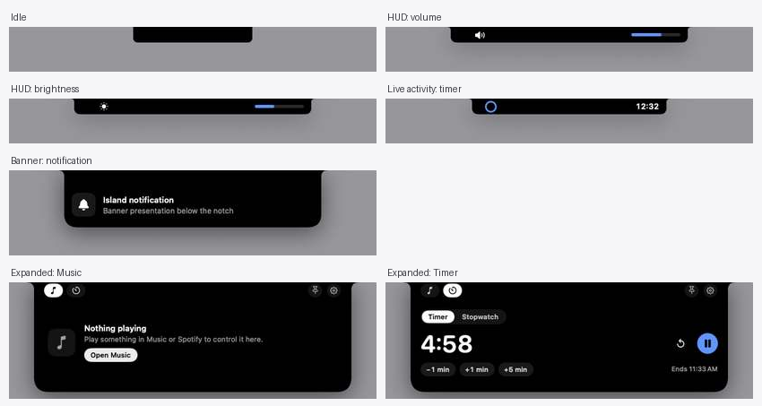

# Отчёт о тестировании

Здесь записано, что **действительно запускалось** и с каким результатом, а что требует ручной
проверки на MacBook с вырезом. Разработка шла в Linux-контейнере без macOS. Поэтому код
приложения собирается и запускается на macOS-раннерах GitHub Actions (workflow
`.github/workflows/build.yml`), а логика ядра дополнительно проверяется локально на Linux.

## 1. Автоматические проверки

| Проверка | Где | Результат |
|---|---|---|
| Юнит-тесты `IslandCore` (112 тестов) | Linux, Swift 6.1 (Docker и GitHub Actions) | ✅ 112/112 |
| Юнит-тесты `IslandCore` | macOS, SwiftPM, новейший Xcode на `macos-15` | ✅ 112/112 |
| Сборка приложения Release (`xcodebuild`, Xcode 26.3, Swift 6.2.4) | macOS 15.7 | ✅ `BUILD SUCCEEDED`, 0 ошибок, 0 предупреждений в коде приложения |
| Интеграционные тесты приложения (`xcodebuild test`, таргет `AlcoveInspiredTests`) | macOS, внутри запущенного приложения | ✅ 25/25, `TEST SUCCEEDED` |
| Альтернативная сборка SwiftPM + упаковка `.app` (`Scripts/build-app.sh --spm`) | macOS | ✅ собран и подписан ad-hoc `.app` |
| Смоук-тест: запуск, 7 состояний острова + покой, скриншоты, отсутствие крэшей | macOS (Debug) | ✅ 0 сбоев, приложение работает во всех состояниях, крэш-репортов нет |
| Потребление ресурсов в покое (`top`, через 12 с после запуска) | macOS | ✅ CPU 0.0 %, память 12 МБ, 6–7 потоков |

Прогоны CI: [Actions ветки `claude/epic-thompson-attfrq`](https://github.com/Boboduk/macbook/actions?query=branch%3Aclaude%2Fepic-thompson-attfrq).
Среда: Xcode 26.3 (17C529), Swift 6.2.4, macOS 15.7.9, Apple Silicon.

### Что покрывают юнит-тесты

| Набор | Тестов | Что проверяется |
|---|---|---|
| `ActivityManagerTests` | 18 | Истечение временных активностей, обновление на месте с перезапуском таймера, политика `keepTimer`, 200 быстрых событий подряд без роста очереди, ожидание менее важных, вытеснение более важными с возвратом и сохранением оставшегося времени, отбрасывание устаревших HUD, порядок «приоритет → FIFO», ограничение очереди, удержание под курсором с льготным периодом, выбор главной live-активности, истечение и продление live-активностей, завершение в любой коллекции, отключение модуля |
| `IslandControllerTests` | 22 | Hover → подсветка → раскрытие после задержки, короткое наведение не раскрывает, режимы наведения, сворачивание с задержкой и его отмена, клик, закрепление, live-активность в compact, возврат к предыдущей активности после HUD, удержание баннера, клик по баннеру открывает вкладку, оверлеи в раскрытом виде, выбор вкладки, все свайпы, удержание во время перетаскивания слайдера, полноэкранное скрытие, отсутствие хаотичного раскрытия при быстрых событиях |
| `EventRouterTests` | 12 | Длительности и стиль HUD из настроек, отключённые модули, тайм-аут паузы музыки, баннер смены трека, таймер, батарея, уведомления, ограничение журнала |
| `LayoutTests` | 11 | Покой совпадает с вырезом, монотонный рост размеров, всё помещается в панель при любом масштабе, ограничение по ширине экрана, радиусы, резервный режим без выреза |
| `SettingsTests` | 8 | Сохранение и чтение после «перезапуска», частичный документ, повреждённая секция не ломает остальные, мусор → значения по умолчанию, ограничение диапазонов, сброс |
| `TimerTests` | 11 | Жизненный цикл таймера, корректность после сна, ±время, Codable, секундомер и круги, форматирование времени, интерполяция позиции трека |
| `ParsingTests` | 16 | Уведомления Music/Spotify, ответы AppleScript, нормализация ID трека, декодирование медиаклавиш, шаги громкости/яркости, распознавание свайпов трекпада и колеса, переходы питания, планировщик |
| `SystemNotificationTests` + `MediaRemoteTests` | 14 | Разбор записей базы Центра уведомлений (bplist, запасной bundle id, мусор), фильтр (своё/заглушённое/устаревшее), распознавание действия «Закрыть», зеркалирование в роутере (заголовок из имени приложения, скрытие текста, mute), значения по умолчанию у старого документа настроек; разбор строкового протокола MediaRemote (ready/error, браузер, пауза, пусто, команды), источник `.system`, имя плеера в баннере смены трека |

### Интеграционные тесты приложения (`AlcoveInspiredTests`)

Выполняются внутри настоящего процесса приложения (test host), поэтому AppKit, AppleScript и
системные сервисы работают по-настоящему:

| Набор | Что проверяется |
|---|---|
| `AppleScriptRunnerTests` | Выполнение AppleScript вне главного потока; разбор списка (строки, real, integer, boolean) по кодам Apple Event; разбор ответа в формате скрипта состояния плеера; ошибки компиляции |
| `CoordinatorIntegrationTests` | Событие громкости → compact-HUD нужного размера; стиль «под вырезом» → баннер; выключение и включение острова; закрепление из настроек; клик и клик вне острова; смена размера острова меняет панель; свайпы доходят до приложения |
| `ControllerIntegrationTests` | Таймер публикует live-активность и восстанавливается после «перезапуска»; секундомер и круги; хранилище настроек ограничивает значения, сохраняет и уведомляет; идентичность трека; цвет акцента из обложки читаем на чёрном |
| `WindowAndGeometryTests` | Конфигурация `NSPanel` (уровень, поведение в Spaces, не берёт фокус, сквозные клики); панель прижата к верху каждого подключённого экрана; форма острова не выходит за рамки при любых радиусах; расписание обновлений по целым секундам; CoreAudio, IOKit и DisplayServices запускаются и останавливаются без ошибок |
| `NotificationDatabaseReaderTests` | Чтение синтетической базы Центра уведомлений (таблицы `app`/`record`): отметка максимального id при старте без повтора истории, разбор записей и запасной bundle id из join, курсор «только новее», отсутствие базы не считается отказом доступа |
| `MediaRemoteBridgeTests` | Мост запускает вспомогательную библиотеку через `/usr/bin/perl` и получает сообщение (`ready` или `error`), не зависая; пропускается, если библиотека не вложена в test host |
| `SystemNotificationMirrorTests` | Старт/переключение/остановка зеркала затрагивают реальный путь базы и FSEvents без сбоев, независимо от того, выдан ли полный доступ к диску |

## 2. Визуальная проверка в CI

Смоук-тест запускает Debug-сборку с аргументом `--ui-test-state <состояние>` (только Debug).
Аргумент переводит остров в нужное состояние через настоящие пути кода (координатор, таймер,
уведомления). Затем тест делает скриншот. Скриншоты сводятся в контакт-лист, он лежит в
артефакте **diagnostics**. Дисплей CI-раннера без выреза, поэтому остров показан в резервном
режиме (пилюля в центре строки меню).

Проверено по скриншотам:

* **idle**: чёрная пилюля в центре строки меню;
* **hud-volume / hud-brightness**: значок слева, полоса уровня справа, акцентный цвет;
* **banner-notice**: остров опускается ниже строки меню, значок, заголовок, текст;
* **expanded-music**: вкладки «Музыка/Таймер» слева, «Закрепить/Настройки» справа, пустое состояние
  «Nothing playing» с кнопкой «Open Music» (на CI нет плеера);
* **expanded-timer**: идущий обратный отсчёт 4:59, пауза/сброс, ±минуты, время окончания;
* **timer-compact**: кольцо прогресса и оставшееся время у выреза;
* **settings**: окно настроек с боковой панелью разделов.

Тестом выявлено и исправлено: таймер, запущенный в одном состоянии, восстанавливался при
следующем запуске. Это ожидаемое сохранение состояния, поэтому смоук-тест теперь сбрасывает
настройки между запусками.

## 3. Ручная проверка на MacBook

Эти сценарии зависят от реального оборудования, разрешений macOS и взаимодействия
пользователя. На CI-раннере (виртуальный дисплей без выреза, без звука и аккумулятора)
их проверить нельзя. **Они не запускались**; ниже чек-лист для проверки:

| # | Сценарий | Ожидаемое поведение |
|---|---|---|
| 1 | Запуск на MacBook с вырезом | Остров точно закрывает вырез, в покое не виден |
| 2 | Навести курсор на вырез | Остров слегка увеличивается; через 0.3 с раскрывается («Наведение → Раскрывать») |
| 3 | Увести курсор | Сворачивается через ~0.45 с без рывков |
| 4 | Клик по острову / вне острова | Раскрытие и сворачивание; клики по окнам под пустой частью панели проходят насквозь |
| 5 | Включить музыку в Music / Spotify | Обложка и индикатор у выреза; в раскрытом виде трек, прогресс, кнопки; запрос «Автоматизация» при первом использовании |
| 6 | Смена трека | Баннер с названием на 3 с, потом снова compact |
| 7 | Клавиши громкости | HUD у выреза (вместе с системным, пока замена HUD выключена) |
| 8 | Подключить AirPods или наушники | Баннер с названием устройства |
| 9 | «Заменить системный HUD» + разрешение | Системный OSD не появляется, работает ⌥⇧ |
| 10 | Клавиши яркости (с разрешением) | HUD яркости |
| 11 | Таймер на 1 минуту, свернуть, переключить приложения | Кольцо и время у выреза; по окончании баннер, звук и уведомление |
| 12 | Таймер + сон/блокировка на время большее, чем таймер | После разблокировки таймер завершён |
| 13 | Подключить/отключить зарядку | HUD батареи |
| 14 | Полноэкранное приложение | Остров на месте (или скрыт при включённой опции) |
| 15 | Подключить внешний монитор, сменить разрешение | Остров остаётся у выреза встроенного дисплея; «Основной дисплей» переносит его |
| 16 | Закрыть крышку с внешним монитором | Остров переходит в резервный режим на внешнем мониторе |
| 17 | Сменить настройки и перезапустить | Всё сохранилось |
| 18 | «Запуск при входе» | Приложение появляется в «Объектах входа», стартует после перезагрузки |
| 19 | Activity Monitor через 10 минут работы | CPU ~0 % в покое, память стабильна |
| 20 | Воспроизвести видео в Safari/Chrome или трек в VLC (система «Сейчас играет» включена) | Обложка и трек у выреза; в раскрытом виде имя приложения, прогресс, ⏮ ⏯ ⏭ работают без запроса «Автоматизация» |
| 21 | Выключить «Показывать воспроизведение из всех приложений» | Остаются только Apple Music и Spotify; при первом управлении запрашивается «Автоматизация» (резервный режим) |
| 22 | Включить «Зеркалировать уведомления» и выдать полный доступ к диску; прислать уведомление из другого приложения | Баннер в острове с иконкой и текстом приложения в течение заданного времени |
| 23 | Заглушить приложение в списке и прислать от него уведомление | Остров его не показывает |
| 24 | Включить «Закрывать системный баннер» (+ «Универсальный доступ») | Экспериментально: системный баннер закрывается; при несовпадении раскладки — без эффекта (используйте стиль «Нет»/фокусирование) |

### Замечания по новым функциям

* **Система «Сейчас играет»** зависит от приватного `MediaRemote`, загружаемого через
  `/usr/bin/perl`. На конкретной сборке macOS трюк может перестать работать — тогда приложение
  само откатывается на Apple Music/Spotify. Это нельзя проверить на CI (нет звука и плеера), и
  это **не запускалось на реальном железе** — см. чек-лист выше.
* **Зеркалирование уведомлений** требует полного доступа к диску и читает базу Центра
  уведомлений. Схема базы (`record`/`app`) приватная и может меняться между версиями macOS;
  разбор записей покрыт юнит-тестами на синтетической базе, но путь «реальное уведомление →
  остров» нужно проверять вручную.
